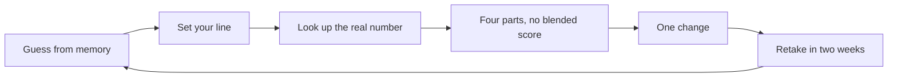

# Virtual Reality Check

Are you living in a virtual world, or the real one? Guess eight numbers about your last week, set the line that would bother you, then look up the truth.

**[Open it →](https://amalmehta.github.io/VirtualRealityCheck/)**

| Start | Guess | Dark mode on a phone |
|---|---|---|
|  |  |  |

- Private: no account, no server, no analytics. Your answers stay in your browser, with export and delete.
- Honest: the verdict rules are invented and labelled that way, and every cited fact links to its source.

**Docs:** [Instructions](docs/INSTRUCTIONS.md) · [System design](docs/SYSTEM-DESIGN.md) · [File structure](docs/FILE-STRUCTURE.md) · [Prompt log](docs/PROMPTS.md) · [Review checklist](docs/REVIEW-CHECKLIST.md) · [Spec](VirtualRealityCheck.md)
