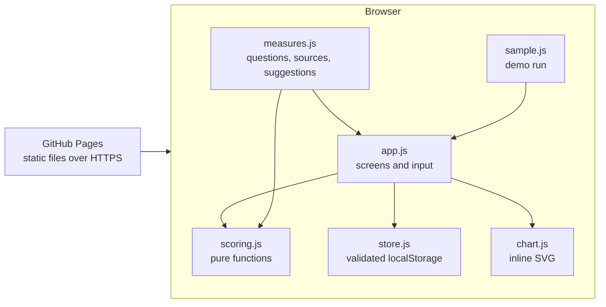

# System Design

Virtual Reality Check is a static website. You guess eight numbers about your last seven days, set the line that would bother you, look up the real numbers, and get a profile and one change to try. There is no server.

## Architecture

| Piece | Job | Can be replaced without touching |
|---|---|---|
| `measures.js` | All content: questions, lookup directions, sources, suggested changes | Scoring and UI |
| `scoring.js` | Over-the-line, surprise, verdicts, comparison. No DOM, no storage | Everything else |
| `store.js` | Reads, writes, validates, exports and deletes saved data | UI (swap for sync later) |
| `chart.js` | Draws one measure's guess, line and actual | Scoring |
| `app.js` | Screens, keyboard, autosave, settings, feedback | Scoring and storage |

## Main flow

1. **Guess.** One measure at a time: your guess, and your line. Nothing is looked up yet.
2. **Check.** The same eight, with directions for where to find each. "Can't check" is allowed and is shown as unchecked.
3. **Result.** Sentence first, then four parts, then each measure's guess, line and actual, then one change you write down.
4. **Retake.** Saved runs are compared, because one run shows a snapshot and drift needs two.

Every input saves at once, so leaving for the Settings app on the same phone loses nothing.

## Where data lives

Only in this browser's `localStorage`, under one key, `virtual-reality-check`. Nothing is sent anywhere. The page's content security policy blocks all outside requests.

## Key decisions

| Decision | Why | Cost |
|---|---|---|
| Static site, no build step | Fewest moving parts; free to host | No sync between devices |
| Your own line, set before looking | No validated cut-off exists for most of these numbers; a line you commit to is checkable | Can be gamed by a loose line, so sources sit next to it |
| No blended total | The parts are unlike; a total implies false precision | Less shareable |
| MathML for the formula | Built into browsers; no dependency | Slight font differences between browsers |
| Self-hosted fonts | No request to a font CDN, so your IP goes nowhere | About 100 KB in the repo |
| Vanilla JS modules | Small, dependency-free, nothing to keep current | Rendering by hand |
| No known numbers on the guess screen | Showing a median there would anchor the guess and the line, which defeats the point | You only see them on the result |
| Guesses lock once you start looking | A guess edited after seeing the answer measures nothing | A typo can't be fixed after that point |
| Strips always start at zero | A strip zoomed to its own range made a 10% gap look huge | Small gaps look small, which is correct |
| Navigation renders at once, not on `hashchange` | Faster, and a quick Next can't land on the old screen | Slightly more routing code |

Alternatives considered: iOS Screen Time alone gives hours but no guess, no line, nothing on people or body. A plain quiz is only your opinion played back. A one-day experiment is stronger evidence but few would come back to finish it. Blocker apps such as Opal or one sec act on the phone but don't tell you whether you've drifted.

## Threat model

The site has no accounts or server, so nobody else's data can be reached through it. The realistic risks:

| Risk | Handling |
|---|---|
| Someone using the same browser reads your runs | Said plainly in the app. Delete everything is in Settings. Not encrypted at rest beyond your device's own disk encryption, because a key held in the same browser would add no real protection. |
| A malicious imported file | Import is validated field by field; numbers are range-checked; text is length-limited and only ever rendered with `textContent` |
| Script injection | No `innerHTML` with user data; strict content security policy; no third-party scripts |
| Answers leaking through URLs, logs or analytics | No analytics, no logging, no answers in URLs. The feedback link carries nothing from your answers. |
| Tampering in hosting | GitHub Pages over HTTPS; no dependencies at runtime |

## Testing

- `npm test`: unit tests on scoring, storage validation and content (every measure has directions and a source or an explicit "no agreed number").
- `npm run test:e2e`: Playwright on sample runs, desktop size in Chromium and iPhone size in WebKit (Firefox isn't covered): full flow, skipped checks, bad input, resume after reload, comparison, import of a bad file, delete, dark mode, reduced motion.
- `docs/REVIEW-CHECKLIST.md`: what tests can't check.

Profiled slowest interaction, click to next frame on the sample result, the longest page (2026-10-30, this Mac): about 35 ms in WebKit (67 ms cold) and about 22 ms in Chromium (55 ms cold). Not measured on a real phone; that's on the checklist.

## Scale and what would change

One person, a handful of runs a year, so `localStorage` is plenty. If people want runs across devices, `store.js` would gain an encrypted sync backend, which also brings accounts. If it ever had to read Screen Time directly, it would have to be a native app, since the web has no access; that is the most likely reason to rebuild.

## Next ten steps, and what they need

1. Sources verified. 2. Measures content. 3. Scoring tests. 4. Screens. 5. Chart. 6. Settings, feedback, data controls. 7. Sample run and e2e. 8. Publish. 9. You take it for real. 10. You retake in two weeks and see whether the comparison says anything useful. What you do at step 9 decides the rest: if you skip lookups, cut measures; if the change helps, add reminders. Keeping content, scoring and storage apart keeps all of that cheap.

## Known limits

- Numbers are typed in by hand; nothing stops you typing the wrong one.
- Verdict rules are invented, and labelled so in the app.
- Phone numbers miss laptop time, so a desk job barely shows here. That suits the feed question better than a total-hours question would, but it is a real gap.
- Research on screen time and wellbeing is mostly about averages and is contested. This site tells you what your week was, not whether it harmed you.
